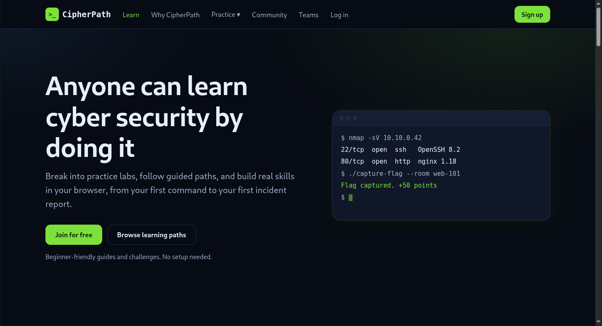

# CipherPath

A cyber security learning landing page with a working account system. The front end uses semantic HTML5, modern CSS3 and vanilla JavaScript (no frameworks). The back end uses Node.js, Express and SQLite.

> **Disclaimer:** CipherPath is an educational portfolio project. Its general layout is inspired by public cyber security training landing pages. It is **not affiliated with, endorsed by, or connected to TryHackMe** and uses none of its assets or branding. All statistics, testimonials, company names and learning paths are placeholders.

**Live demo:** https://mv8jtmqr34qb-production-6dmody2l.us-central1.suga.run
(Hosted on a free tier, so it may occasionally be unavailable.)

<!-- Add a screenshot after committing it to the repo:  -->

## Features

### Landing page
- Responsive layout with a mobile menu, a dropdown, and active-section highlighting on scroll
- Hero section with an animated terminal graphic
- Learning path cards with two combinable filters (experience level and target role) and a live result count
- Accessible tabbed showcase with full keyboard support
- FAQ accordion, scroll-triggered reveal animations, and a testimonials marquee with a pause control
- Dark theme driven by CSS custom properties, fluid typography with `clamp()`, and `prefers-reduced-motion` support

### Accounts
- Sign up, log in and log out
- Dashboard showing per-user progress on each learning path, saved on the server
- Settings page: change username and email, change password, and delete the account
- Pages that require a login redirect to the login page when there is no active session

## Tech stack

| Layer | Technology |
|---|---|
| Front end | HTML5, CSS3, vanilla JavaScript (ES6+) |
| Back end | Node.js 22.13 or newer, Express 4 |
| Database | SQLite via the built-in `node:sqlite` module |

## Getting started

**Prerequisites:** Node.js 22.13 or newer (`node -v`).

```bash
git clone https://github.com/code-huzaifa349/cipher-path.git
cd cipher-path
npm install
npm start
```

Open http://localhost:3000.

### Configuration

| Variable | Default | Purpose |
|---|---|---|
| `PORT` | `3000` | Port the server listens on |
| `NODE_ENV` | (unset) | Set to `production` to mark session cookies as `Secure` (requires HTTPS) |
| `DATA_DIR` | `./data` | Directory that holds the SQLite database file |

## Project structure

```
cipher-path/
├── server.js          # Express app, API routes, database access
├── package.json
└── public/            # Static front end served by Express
    ├── index.html     # Landing page
    ├── login.html, signup.html, dashboard.html, settings.html
    ├── style.css      # Design tokens, components, landing page sections
    ├── auth.css       # Styles for the account pages
    ├── script.js      # Landing page interactions
    ├── app.js         # API client, forms, dashboard, settings
    └── assets/
```

## API

All routes are under `/api` and use JSON. Routes marked with a lock require a valid session.

| Method | Route | Description |
|---|---|---|
| POST | `/signup` | Create an account and start a session |
| POST | `/login` | Start a session |
| POST | `/logout` | End the current session |
| GET | `/me` 🔒 | Current user |
| PATCH | `/me` 🔒 | Update username and email (requires current password) |
| POST | `/me/password` 🔒 | Change password (ends all other sessions) |
| DELETE | `/me` 🔒 | Delete the account and its data (requires password) |
| GET | `/paths` 🔒 | Learning paths with the user's progress |
| POST | `/progress` 🔒 | Mark the next step of a path as done |

## Security

- Passwords are hashed with `scrypt` and a unique random salt; plain-text passwords are never stored
- Session tokens are random, stored only as SHA-256 hashes, and sent in `httpOnly`, `SameSite=Lax` cookies (`Secure` in production)
- State-changing requests must carry a custom header, which cross-site forms cannot send (CSRF protection); CORS is not enabled
- Login failures return one generic message, and unknown emails cost the same time as real ones
- Rate limiting on signup, login, password change and account deletion
- Parameterized SQL queries, server-side validation, and `textContent` rendering for user data
- Strict Content Security Policy and common security headers
- Changing a password signs out every other device

## Accessibility

Skip link, visible `:focus-visible` states, ARIA tabs and disclosure patterns, `aria-live` regions for filter results and form errors, labelled form fields, reduced-motion support, and a usable layout without JavaScript where practical.

## Deployment notes

The server must run as a long-lived Node process, so serverless platforms with temporary file systems are not suitable. Set `PORT` and `NODE_ENV=production`, and mount a persistent volume with `DATA_DIR` pointing at it. Without persistent storage the SQLite database is lost on every redeploy.

## Known limitations

- No email verification or password reset (these need an email service)
- The rate limiter is in memory, so it assumes a single server instance
- No automated tests yet; features were verified manually
- Learning path content, statistics and testimonials are placeholders

## Author

**Huzaifa Khan** · [GitHub](https://github.com/code-huzaifa349) · [LinkedIn](https://www.linkedin.com/in/huzaifa-khan-bb3660435)
